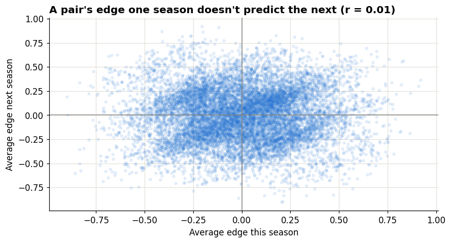

**Question 1 (Madi):** Matchup edges across eras
Do the situational edges from 2 supposed teams hold in every era, or are they getting weaker? (AKA do team advantage
/ effectiveness against certain teams stay consistent through time or is it solely dependent on the players?)

**Data:** FiveThirtyEight NBA Elo dataset, NBA regular season 1979-80 to 2014-15.
After cleaning: 39,620 games, one row per game (q1_games_clean.csv).

**Cleaning:**
- Kept NBA regular season games from 1979-80 on, and dropped ABA, playoff and neutral-site games
- Removed duplicate rows (each game was listed twice, once from each team's side)
- Used FiveThirtyEight's franchise ID so relocated teams stay together (for example, the Sonics and the Thunder)
- Added each team's points relative to that season's league average, since scoring changes a lot across eras
- Checked our league-average points against Brandon's Basketball-Reference dataset: they match within 0.1 points
- every season, so the data cleaning is verified

**Key variable:** edge = win (1 or 0) minus forecast (the pre-game win probability). Positive means a team did
better than expected, after accounting for both teams' strength and home court. Since a single game's edge is
all or nothing, we averaged edge for each team pair in each season (12,974 pair-seasons).

### Plots

**1. Pair edges look similar in every era**

Edges are centered near 0 in all three eras. They spread out a little more in later eras (spread 0.26, 0.28, 0.29), but pairs also played fewer games per season as more teams joined (about 3.5 down to 2.8), which makes averages noisier.

**2. A pair's edge one season doesn't predict the next**

If matchup edges were real and lasting, this would slope upward. Instead it's a round cloud. The correlation between a pair's edge in one season and the next is 0.01.

**3. Edges don't carry over in any era**

| Era | Correlation (this season vs. next) |
|---|---|
| 1980-1994 | 0.00 |
| 1995-2004 | -0.01 |
| 2005-2015 | 0.04 |

### Finding
Once team strength is accounted for, matchup edges mostly don't last. A team that beats a specific opponent by more than expected one season is no more likely to do it again the next season, and this is true in every era.

### Recommendation for NBA analysts
Don't rely on past head-to-head records ("Team A has Team B's number") to predict future matchups. Current team strength is a better guide, since matchup edges don't carry over from season to season.

### Limitations
- Teams only play each other 2 to 4 times a season, so single seasons are noisy
- The data ends in 2014-15, so it doesn't cover the recent three-point era
- We can't yet say whether edges come from the players. That would need player-level data.

*Question 2 (James)* Impact of Hand-checking Ban
How did the hand-checking ban implemented in 2004 affect guard performance overall?

