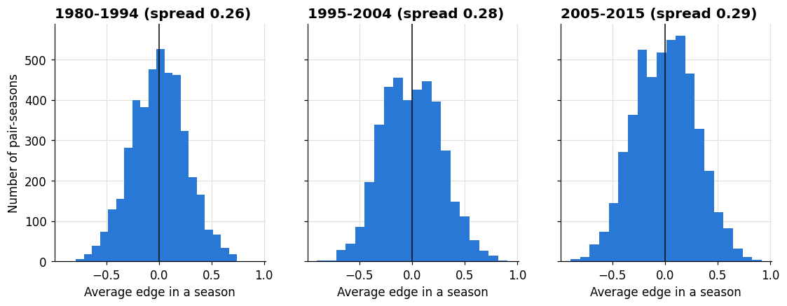
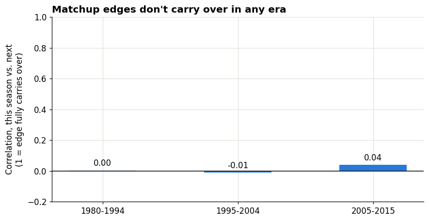

## **Question 1 (Madi):** Matchup edges across eras
Do some teams consistently do better against specific opponents than expected, and does that hold in every era?

**Data Sources:**
q1_games_clean.csv, E&P_matchup_EDA.ipynb
Original data from FiveThirtyEight's NBA Elo dataset (regular season, 1979-80 to 2014-15)

**Key Variable:** edge = win (1 or 0) minus forecast (pre-game win probability). A positive edge means a team did better than expected against that opponent. We averaged edge for each team pair in each season.

**Chosen Plots**
1. Average Edge per Team Pair, by Era

Notable Observations: Edges are centered near 0 in all three eras. They spread out slightly more in later eras, but teams also played each other fewer times per season as more teams joined the league, which makes the averages noisier.

2. Edge This Season vs. Next Season (Scatter Plot)

Notable Observations: If matchup edges lasted, this plot would slope upward. Instead it forms a round cloud, with a correlation of about 0.01. A pair's edge one season does not predict its edge the next season.

3. Correlation of Edge Between Seasons, by Era (Bar Chart)

Notable Observations: The correlation is close to 0 in every era (0.00, -0.01 and 0.04), far below 1, which would mean edges fully carry over.

**Conclusions + Takeaways**
- Once team strength is accounted for, matchup edges do not carry over from one season to the next, in any era.
- Past head-to-head records are not a reliable way to predict future matchups. Current team strength is a better guide.
- Edges may depend more on the current players than the franchise, but we would need player-level data to confirm this.

## **Question 2 (James)** Impact of Hand-checking Ban
How did the hand-checking ban implemented in 2004 affect guard performance overall?

**Data Sources:** 
3ptfiltered.ipynb, midfiltered.ipynb, pts&To.ipynb 
Original data from NBA.com

**Chosen Plots**
1. 3 Point Percentage Accuracy Box Plot

Notable Observations: The median 3-point percentage accuracy increased by roughly 2% for 2004-2005, and the box plot for the 2004-2005 season is more symmetric compared to 2003-2004 (more skewed left). Indicates that before the hand-checking ban, many players shot far below the median (although low outliers are common in both boxplots).

2. Mid Point Percentage Accuracy Box Plot

Notable Observations: The median mid-point percentage accuracy increased by roughly 1% for 2004-2005. Furthermore, in the 2003-2004 boxplots, there are multiple low outliers, but there are virtually none in the 2004-2005 plot. Instead, there are numerous high outliers. 

3. Grouped Scatter with Regression Lines Showing Relation between Points and Turnovers

Notable Observations: show linear trend indicating number of turnovers relative to number of points scored. **Note:** higher points correlate with higher turnovers (more minutes on court). However, the 2004-2005 guards had less turnovers relative to points scored compared to 2003-2004 guards. For a fixed number of points guard would score, the expected turnovers would be less. 

**Conclusions + Takeaways**
- There was no significant change in 3-point percentage, mid-range percentage, or the expected turnovers depending on number of points scored. 
- However, we could see that there is a small increase in 3-point and mid-range percentage, as well as less expected turnovers for points scored.
- Overall conclusion: Guards begun to display higher impact in the game due to less defensive pressure and not having to rely as much on centers & forwards. (could create their own shots)
